# Mockups dos e-mails do Conecta CRPRS

Todos os e-mails que o sistema envia, com dados fictícios (solicitante *Maria Souza*, demanda *#CRPRS2026-0001*, setor *Cadastro*). Abra `index.html` no navegador para a galeria, ou veja as imagens abaixo.

## Resumo

| # | E-mail | Quando é enviado | Para quem |
|---|---|---|---|
| 1 | [Confirmação de demanda criada](imagens/01-demanda-criada.png) | Assim que uma demanda é aberta: por um e-mail recebido na caixa do setor, pelo formulário "Nova Demanda" do sistema ou por um sistema integrado (API). | O solicitante da demanda. |
| 2 | [Confirmação de demanda criada (com anexos rejeitados)](imagens/02-demanda-criada-anexos-rejeitados.png) | Mesmo momento do e-mail anterior, mas só quando a demanda nasce de um e-mail com anexos que o sistema recusou (tipo não permitido, mais de 5 arquivos ou mais de 20MB). | O solicitante da demanda. |
| 3 | [Resposta da equipe](imagens/03-resposta-da-equipe.png) | Quando um atendente escreve um comentário na demanda com a opção "Enviar por e-mail" marcada (também no botão "Enviar e Fechar"). Notas internas nunca geram este e-mail. | O solicitante da demanda. Os anexos do comentário seguem junto. |
| 4 | [Cópia da resposta da equipe](imagens/04-resposta-em-copia.png) | Junto com a "Resposta da equipe", quando o atendente preenche o campo "Com cópia" ao comentar. Sai uma mensagem para cada endereço informado. | Cada endereço do campo "Com cópia" (pessoas que não são o solicitante). |
| 5 | [Confirmação de comentário recebido](imagens/05-comentario-recebido.png) | Quando o solicitante responde por e-mail a uma demanda (assunto com #NNNNN) e a resposta é registrada como comentário. | Quem enviou a resposta (o remetente do e-mail recebido). |
| 6 | [Primeira resposta (demanda assumida)](imagens/06-primeira-resposta.png) | Quando uma demanda que ainda não tinha responsável é atribuída a um atendente pela primeira vez (inclusive quando o atendente a assume). Também marca a primeira resposta do SLA. | O solicitante da demanda. |
| 7 | [Demanda encerrada](imagens/07-demanda-encerrada.png) | Quando a demanda é encerrada (status encerrado/resolvido que a move para o Arquivo). | O solicitante da demanda. |
| 8 | [Demanda reaberta (aviso ao solicitante)](imagens/08-demanda-reaberta-solicitante.png) | Quando o solicitante responde por e-mail a uma demanda já encerrada e o sistema a reabre automaticamente. | O solicitante da demanda. |
| 9 | [Aviso de nova demanda](imagens/09-nova-demanda-gestores.png) | Junto com a confirmação ao solicitante, sempre que uma demanda é aberta (e-mail recebido, formulário do sistema ou integração). | Os gestores do setor da demanda; um e-mail para cada gestor. |
| 10 | [Aviso de novo comentário do solicitante](imagens/10-novo-comentario-equipe.png) | Quando o solicitante responde por e-mail a uma demanda e a resposta vira comentário. | O atendente responsável pela demanda. Se ainda não há responsável, os gestores do setor (ou os administradores, se não houver gestor). |
| 11 | [Demanda atribuída para você](imagens/11-demanda-atribuida.png) | Quando uma demanda é atribuída a um atendente (por um gestor, administrador ou pelo próprio atendente). | O atendente que passou a ser o responsável. |
| 12 | [Demanda fechada por outro usuário](imagens/12-demanda-fechada-por-outro.png) | Junto com o aviso "Demanda encerrada", quando quem encerrou a demanda não é o atendente responsável por ela. | O atendente responsável, se ativo. |
| 13 | [Demanda reaberta (aviso ao responsável)](imagens/13-demanda-reaberta-equipe.png) | Quando uma demanda encerrada é reaberta: por um atendente que muda o status ou automaticamente quando o solicitante responde por e-mail. | O atendente responsável pela demanda (se houver). |
| 14 | [Novo comentário na sua demanda (de outro atendente)](imagens/14-comentario-entre-agentes.png) | Quando outro atendente, gestor ou administrador comenta numa demanda que está atribuída a você. O status da demanda passa para "Nova Resposta". | O atendente responsável pela demanda. |
| 15 | [Lembrete de demanda](imagens/15-lembrete.png) | Na data e hora agendadas no lembrete (o cron de lembretes dispara a cada rodada). Lembretes de demandas encerradas ou canceladas são cancelados e não enviados. | A pessoa escolhida ao criar o lembrete; se não houve escolha, o responsável pela demanda ou, sem responsável, os gestores do setor. |
| 16 | [Recuperação de senha](imagens/16-recuperacao-de-senha.png) | Quando alguém usa "Esqueci minha senha" na tela de login. É enviado na hora, sem passar pela fila. | O usuário da conta. Solicitantes externos (cliente) não recebem. |

## Detalhes

### Para o solicitante

#### Confirmação de demanda criada

- **De:** Conecta CRPRS - Cadastro <administrador@crprs.org.br>
- **Para:** Maria Souza <maria.souza@exemplo.com.br>
- **Assunto:** 🎫 [#CRPRS2026-0001] Demanda criada - Dúvida sobre inscrição de pessoa jurídica
- **Quando:** Assim que uma demanda é aberta: por um e-mail recebido na caixa do setor, pelo formulário "Nova Demanda" do sistema ou por um sistema integrado (API).
- **Quem recebe:** O solicitante da demanda.
- **Observação:** Sai pela caixa de e-mail do setor da demanda (ou pelo remetente global, se o setor não tiver caixa). Traz a demanda registrada (título e descrição).

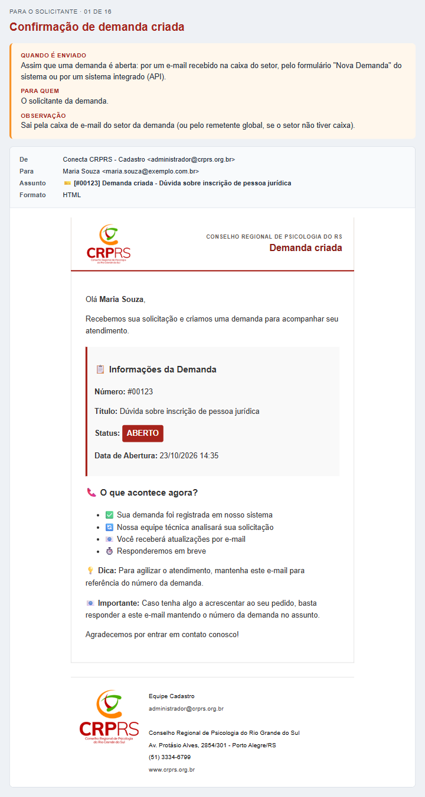

#### Confirmação de demanda criada (com anexos rejeitados)

- **De:** Conecta CRPRS - Cadastro <administrador@crprs.org.br>
- **Para:** Maria Souza <maria.souza@exemplo.com.br>
- **Assunto:** 🎫 [#CRPRS2026-0001] Demanda criada - Dúvida sobre inscrição de pessoa jurídica
- **Quando:** Mesmo momento do e-mail anterior, mas só quando a demanda nasce de um e-mail com anexos que o sistema recusou (tipo não permitido, mais de 5 arquivos ou mais de 20MB).
- **Quem recebe:** O solicitante da demanda.
- **Observação:** É o e-mail anterior com um aviso amarelo, logo abaixo das informações da demanda, listando cada anexo recusado e o motivo.

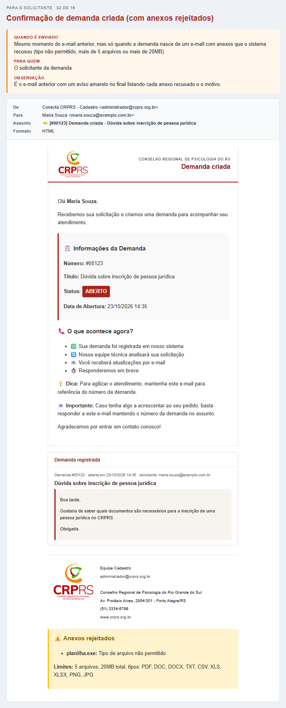

#### Resposta da equipe

- **De:** Conecta CRPRS - Cadastro <administrador@crprs.org.br>
- **Para:** Maria Souza <maria.souza@exemplo.com.br>
- **Assunto:** 🎫 [#CRPRS2026-0001] Resposta da Equipe - Dúvida sobre inscrição de pessoa jurídica
- **Quando:** Quando um atendente escreve um comentário na demanda com a opção "Enviar por e-mail" marcada (também no botão "Enviar e Fechar"). Notas internas nunca geram este e-mail.
- **Quem recebe:** O solicitante da demanda. Os anexos do comentário seguem junto.
- **Observação:** Sai pela caixa de e-mail do setor da demanda e assina como a equipe desse setor.

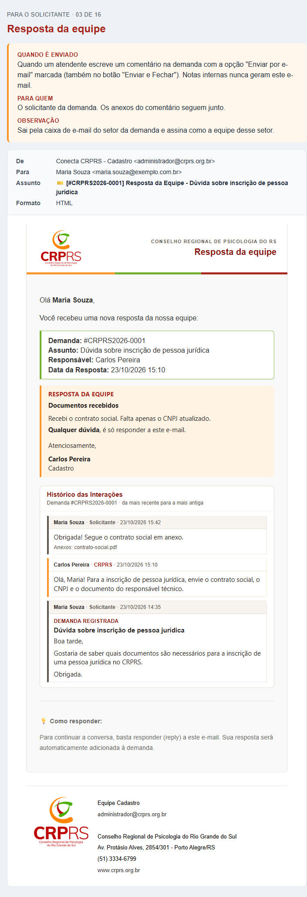

#### Cópia da resposta da equipe

- **De:** Conecta CRPRS - Cadastro <administrador@crprs.org.br>
- **Para:** diretoria@exemplo.com.br (endereço informado no campo "Com cópia")
- **Assunto:** 🎫 [#CRPRS2026-0001] Resposta da Equipe - Dúvida sobre inscrição de pessoa jurídica
- **Quando:** Junto com a "Resposta da equipe", quando o atendente preenche o campo "Com cópia" ao comentar. Sai uma mensagem para cada endereço informado.
- **Quem recebe:** Cada endereço do campo "Com cópia" (pessoas que não são o solicitante).
- **Observação:** Mostra quem é o solicitante e assina como a equipe do setor. Se alguém dessa lista responder ao e-mail com o número da demanda, vira comentário.

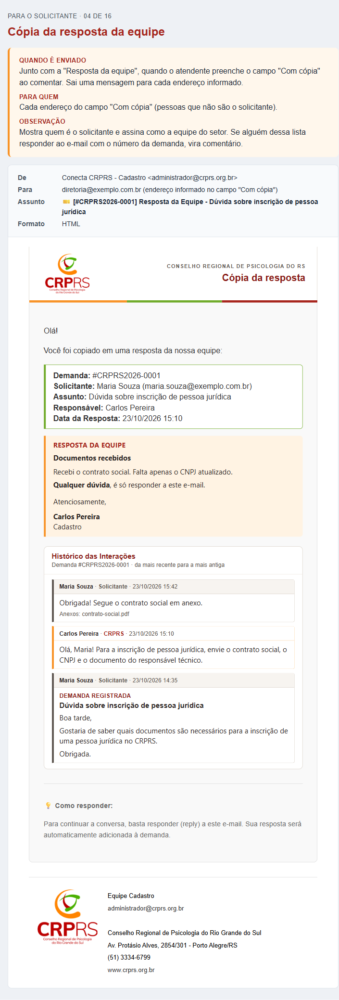

#### Confirmação de comentário recebido

- **De:** Conecta CRPRS - Cadastro <administrador@crprs.org.br>
- **Para:** Maria Souza <maria.souza@exemplo.com.br>
- **Assunto:** 🎫 [#CRPRS2026-0001] Comentário recebido - Dúvida sobre inscrição de pessoa jurídica
- **Quando:** Quando o solicitante responde por e-mail a uma demanda (assunto com #NNNNN) e a resposta é registrada como comentário.
- **Quem recebe:** Quem enviou a resposta (o remetente do e-mail recebido).
- **Observação:** Se houver anexos recusados, um aviso amarelo com os motivos é incluído antes do agradecimento.

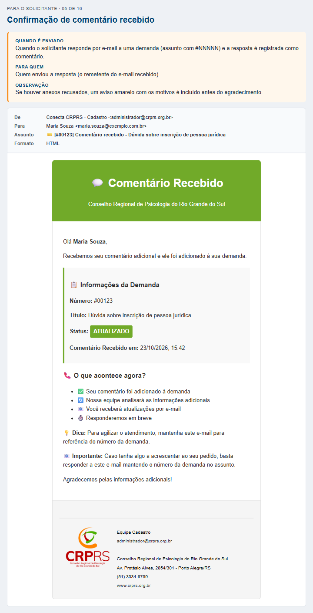

#### Primeira resposta (demanda assumida)

- **De:** Conecta CRPRS - Cadastro <administrador@crprs.org.br>
- **Para:** Maria Souza <maria.souza@exemplo.com.br>
- **Assunto:** 🎫 [#CRPRS2026-0001] Primeira resposta - Dúvida sobre inscrição de pessoa jurídica
- **Quando:** Quando uma demanda que ainda não tinha responsável é atribuída a um atendente pela primeira vez (inclusive quando o atendente a assume). Também marca a primeira resposta do SLA.
- **Quem recebe:** O solicitante da demanda.
- **Observação:** Só sai na primeira atribuição; reatribuições posteriores não geram este e-mail.

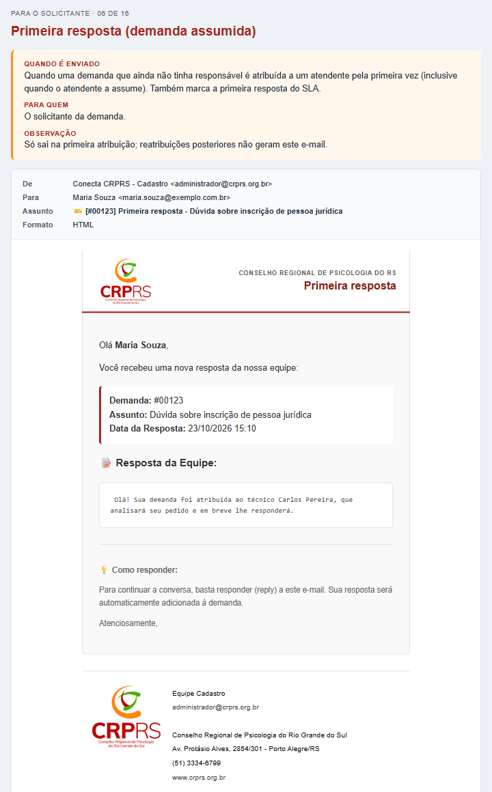

#### Demanda encerrada

- **De:** Conecta CRPRS - Cadastro <administrador@crprs.org.br>
- **Para:** Maria Souza <maria.souza@exemplo.com.br>
- **Assunto:** 🎫 [#CRPRS2026-0001] Demanda encerrada - Dúvida sobre inscrição de pessoa jurídica
- **Quando:** Quando a demanda é encerrada (status encerrado/resolvido que a move para o Arquivo).
- **Quem recebe:** O solicitante da demanda.
- **Observação:** Cancelar uma demanda não envia este e-mail.

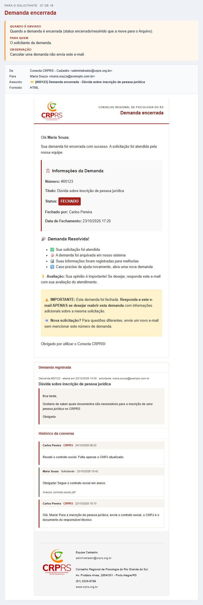

#### Demanda reaberta (aviso ao solicitante)

- **De:** Conecta CRPRS - Cadastro <administrador@crprs.org.br>
- **Para:** Maria Souza <maria.souza@exemplo.com.br>
- **Assunto:** 🎫 [#CRPRS2026-0001] Demanda reaberta - Dúvida sobre inscrição de pessoa jurídica
- **Quando:** Quando o solicitante responde por e-mail a uma demanda já encerrada e o sistema a reabre automaticamente.
- **Quem recebe:** O solicitante da demanda.
- **Observação:** Assina como a equipe do setor da demanda.

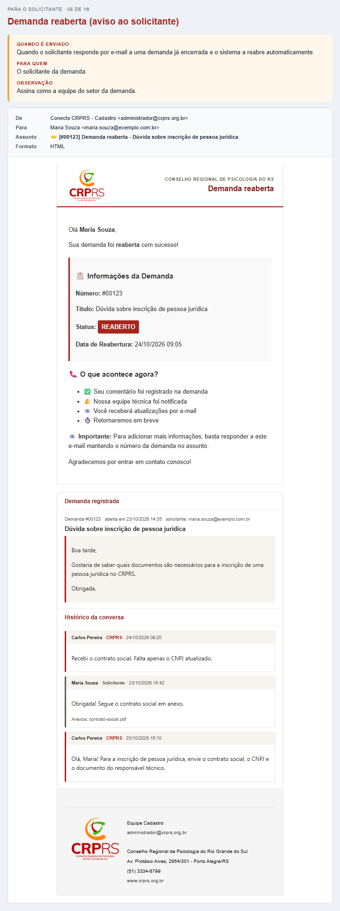

### Para a equipe (internos)

#### Aviso de nova demanda

- **De:** administrador@crprs.org.br (remetente global do sistema)
- **Para:** Gestores do setor da demanda (se o setor não tiver gestor, os administradores)
- **Assunto:** 🎫 [NOVA DEMANDA] #CRPRS2026-0001 - Dúvida sobre inscrição de pessoa jurídica
- **Quando:** Junto com a confirmação ao solicitante, sempre que uma demanda é aberta (e-mail recebido, formulário do sistema ou integração).
- **Quem recebe:** Os gestores do setor da demanda; um e-mail para cada gestor.
- **Observação:** Texto puro, sem modelo HTML. A descrição é cortada em 500 caracteres.

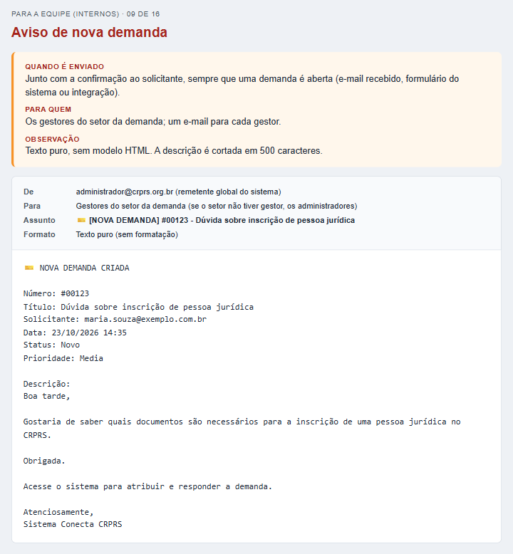

#### Aviso de novo comentário do solicitante

- **De:** administrador@crprs.org.br (remetente global do sistema)
- **Para:** Responsável pela demanda; sem responsável, os gestores do setor
- **Assunto:** 🎫 [#CRPRS2026-0001] Novo comentário - Dúvida sobre inscrição de pessoa jurídica
- **Quando:** Quando o solicitante responde por e-mail a uma demanda e a resposta vira comentário.
- **Quem recebe:** O atendente responsável pela demanda. Se ainda não há responsável, os gestores do setor (ou os administradores, se não houver gestor).
- **Observação:** Texto puro. O corpo do comentário não vai no e-mail: só o aviso para abrir o sistema.

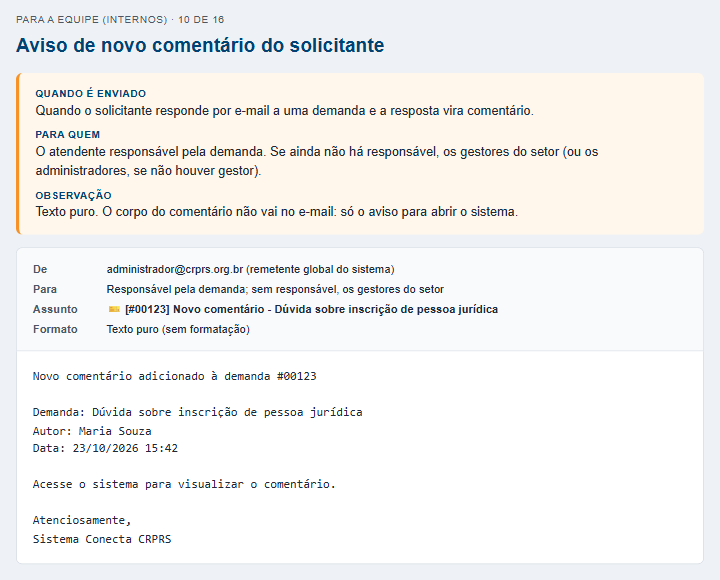

#### Demanda atribuída para você

- **De:** administrador@crprs.org.br (remetente global do sistema)
- **Para:** Carlos Pereira <carlos.pereira@crprs.org.br> (atendente que recebeu a demanda)
- **Assunto:** 👤 Demanda #CRPRS2026-0001 atribuída para você
- **Quando:** Quando uma demanda é atribuída a um atendente (por um gestor, administrador ou pelo próprio atendente).
- **Quem recebe:** O atendente que passou a ser o responsável.
- **Observação:** Texto puro. O sistema também cria uma notificação no sino.

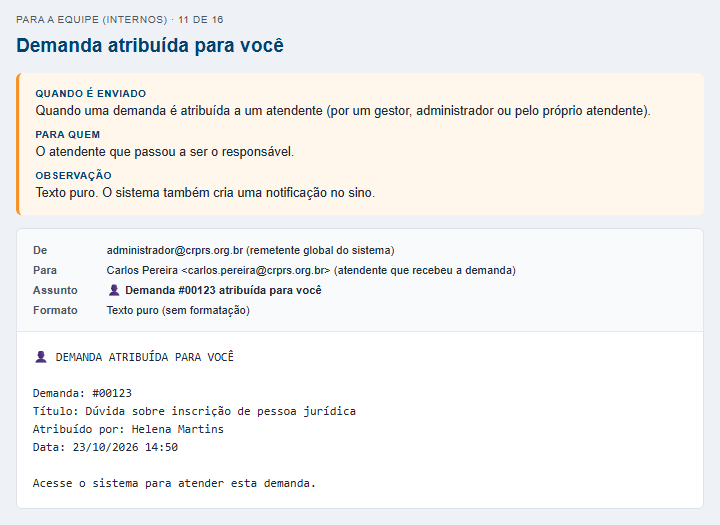

#### Demanda fechada por outro usuário

- **De:** Conecta CRPRS - Cadastro <administrador@crprs.org.br>
- **Para:** Atendente responsável pela demanda (quando quem encerrou foi outra pessoa)
- **Assunto:** 🔒 Demanda #CRPRS2026-0001 foi fechada
- **Quando:** Junto com o aviso "Demanda encerrada", quando quem encerrou a demanda não é o atendente responsável por ela.
- **Quem recebe:** O atendente responsável, se ativo.
- **Observação:** Texto puro. Sai pela caixa do setor da demanda (o código seleciona o remetente do setor antes do fechamento).

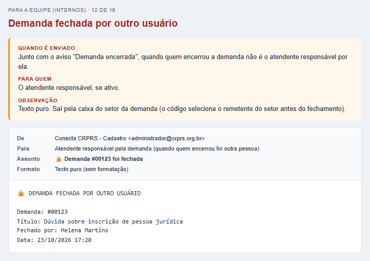

#### Demanda reaberta (aviso ao responsável)

- **De:** administrador@crprs.org.br (remetente global do sistema)
- **Para:** Atendente responsável pela demanda
- **Assunto:** 🔄 Demanda #CRPRS2026-0001 foi reaberta
- **Quando:** Quando uma demanda encerrada é reaberta: por um atendente que muda o status ou automaticamente quando o solicitante responde por e-mail.
- **Quem recebe:** O atendente responsável pela demanda (se houver).
- **Observação:** Texto puro.

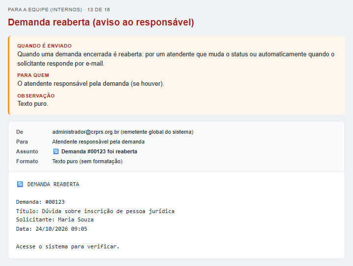

#### Novo comentário na sua demanda (de outro atendente)

- **De:** administrador@crprs.org.br (remetente global do sistema)
- **Para:** Atendente responsável pela demanda
- **Assunto:** 💬 Novo comentário na Demanda #CRPRS2026-0001 - Dúvida sobre inscrição de pessoa jurídica
- **Quando:** Quando outro atendente, gestor ou administrador comenta numa demanda que está atribuída a você. O status da demanda passa para "Nova Resposta".
- **Quem recebe:** O atendente responsável pela demanda.
- **Observação:** Notas internas não geram este e-mail (só a notificação do sistema).

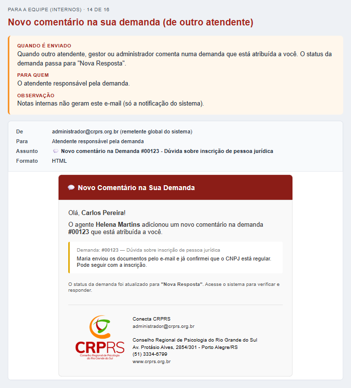

#### Lembrete de demanda

- **De:** administrador@crprs.org.br (remetente global do sistema)
- **Para:** Destinatário escolhido no lembrete; sem destinatário, o responsável pela demanda (ou os gestores do setor)
- **Assunto:** 🔔 [Lembrete] Demanda #CRPRS2026-0001 - Dúvida sobre inscrição de pessoa jurídica
- **Quando:** Na data e hora agendadas no lembrete (o cron de lembretes dispara a cada rodada). Lembretes de demandas encerradas ou canceladas são cancelados e não enviados.
- **Quem recebe:** A pessoa escolhida ao criar o lembrete; se não houve escolha, o responsável pela demanda ou, sem responsável, os gestores do setor.
- **Observação:** O sistema também cria uma notificação no sino. Lembretes de demandas em "Aguardando data" voltam a demanda para "Em atendimento".

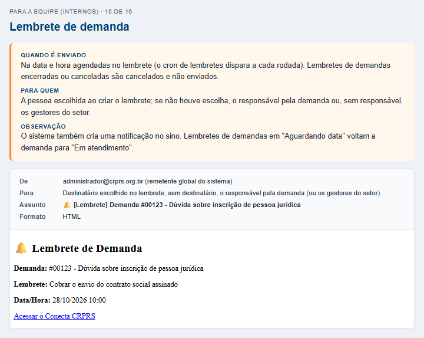

#### Recuperação de senha

- **De:** administrador@crprs.org.br (remetente global do sistema)
- **Para:** O usuário que pediu a recuperação (apenas contas ativas que podem entrar no sistema)
- **Assunto:** Recuperação de Senha - Conecta CRPRS
- **Quando:** Quando alguém usa "Esqueci minha senha" na tela de login. É enviado na hora, sem passar pela fila.
- **Quem recebe:** O usuário da conta. Solicitantes externos (cliente) não recebem.
- **Observação:** O link vale 1 hora e só pode ser usado uma vez. A resposta da tela é sempre a mesma, exista a conta ou não.

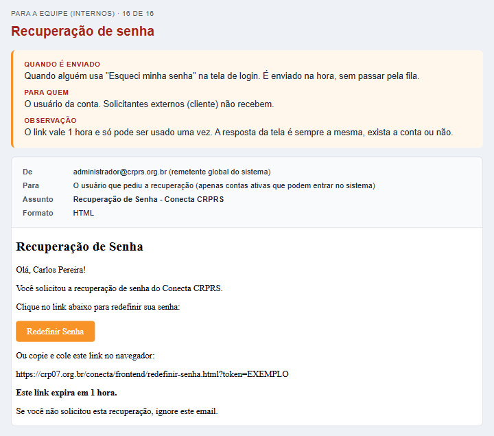

## Como foi feito e como atualizar

- `gerar-mockups.php` monta tudo a partir dos modelos reais de `backend/email-template-*.html`. Rode `php mockups/gerar-mockups.php` depois de mudar um modelo ou um texto de e-mail.
- A **pesquisa de satisfação** (liga/desliga `sol_pesquisa_satisfacao` na aba Envio de E-mails) não está neste catálogo: o Conecta só pede o convite e quem envia o e-mail é o METRICA360 (ver CLAUDE.md, "Pesquisa de satisfação pelo METRICA360").
- Os e-mails montados direto no código (agente→agente, lembrete, recuperação de senha e os avisos em texto puro) são cópias do texto original; atualize o catálogo do gerador quando o código mudar.
- Todos os e-mails ao solicitante trazem no final a **demanda registrada** (título e descrição) e o **histórico da conversa** com o CRPRS, do mais recente para o mais antigo. Notas internas e comentários da equipe que não foram enviados ao solicitante nunca aparecem. A "Resposta da equipe" e a "Cópia da resposta" não repetem a mensagem que acabou de ser enviada.
- `emails/` guarda o e-mail puro (HTML ou texto), `paginas/` a moldura com o momento do envio, `imagens/` os PNGs.
- O logotipo dos e-mails vem de `www.crprs.org.br`; sem internet, a imagem não aparece na pré-visualização.

- Os e-mails internos (equipe) continuam em texto puro, exceto os avisos montados em HTML (comentário de outro atendente, lembrete e recuperação de senha).
